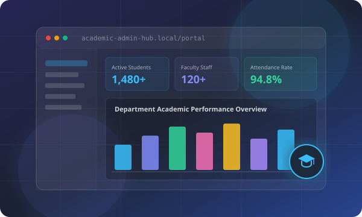

# Kishan P S — Developer Portfolio & Project Showcase

> **Modern Glassmorphic Developer Portfolio** engineered with semantic HTML5, modern CSS3 (Flexbox/Grid & Backdrop Filters), and modular ES6+ JavaScript.



---

## 🌟 Highlights & Features

- **💎 Modern Glassmorphism Aesthetic:**
  - Multi-layered frosted glass panels (`backdrop-filter: blur(16px)`).
  - Ambient glowing floating background lights with smooth floating physics.
  - Subtle glowing chromatic borders, gradient text, and depth drop shadows.

- **🌗 Dark / Light Mode Toggle:**
  - Complete theme switcher with system preference detection (`prefers-color-scheme`) and persistent memory via `localStorage`.

- **⚡ Separate, Clean File Architecture:**
  - `index.html` — Semantic HTML5 markup, accessible landmarks, and rich OpenGraph metadata.
  - `css/style.css` — Robust design system with CSS custom properties (variables), responsive breakpoints, and animations.
  - `js/script.js` — Modular ES6+ JavaScript engine with zero external framework dependencies.

- **📱 Mobile-First Responsive Layout:**
  - Fluid typography with CSS `clamp()`.
  - Accessible mobile slide-down hamburger drawer with backdrop blur and touch optimization.
  - Adaptable layouts for mobile, tablet, and desktop monitors.

- **🚀 Interactive Features & Components:**
  - **Animated Typewriter Subtitle:** Cycles through developer specialties ("Full-Stack Developer", "Computer Science Engineer", "AI & Machine Learning Explorer").
  - **Interactive Glass Code Terminal:** Switchable tabs (`profile.json` and `skills.py`), code syntax highlighting, and 1-click snippet copy button.
  - **Categorized Skills Grid:** Filter technical skills across Frontend, Backend & Languages, Databases & Cloud, AI & Data Science, and Tools.
  - **Featured Projects Showcase with Modal Blueprints:** Detailed interactive modal dialogs displaying project architecture, problem statements, key feature checklists, and GitHub links.
  - **Verified Credentials Showcase:** Direct links to authentic PDF certificates stored locally in `assets/documents/`.
  - **Email One-Click Copy & Toast Alert:** Instant feedback notification system for user interactions.
  - **Contact Form Validation & Client Launch:** Interactive form validation with direct mailto client launching.

---

## 📂 Project Structure

```text
portfolio/
├── index.html                           # Semantic HTML5 single-page application
├── css/
│   └── style.css                        # Glassmorphic CSS design system & media queries
├── js/
│   └── script.js                        # ES6+ interactive engine (modal, theme, filters)
├── assets/
│   ├── documents/                       # Verified resume & course certificates
│   │   ├── Kishan-PS-Public-Resume.pdf
│   │   ├── Elewayte-AI-Internship-Certificate.pdf
│   │   ├── Artificial-Intelligence-Course-Certificate.pdf
│   │   ├── NPTEL-Python-for-Data-Science.pdf
│   │   └── NPTEL-Database-Management-System.pdf
│   └── images/                          # Scalable vector graphics (SVG) project banners
│       ├── avatar.svg
│       ├── project-aah.svg
│       ├── project-medshield.svg
│       ├── project-neuraguard.svg
│       ├── project-smartclass.svg
│       └── project-krishimitra.svg
└── README.md                            # Documentation & deployment guide
```

---

## 👤 Developer Profile & Credentials

- **Name:** Kishan P S
- **Headline:** Computer Science Engineering Student | Full-Stack Developer
- **University:** Navkis College of Engineering, Hassan
- **Academic Score:** 8.9 CGPA
- **Email:** [pskishan9@gmail.com](mailto:pskishan9@gmail.com)
- **GitHub:** [github.com/Kishangowda-06](https://github.com/Kishangowda-06)
- **LinkedIn:** [linkedin.com/in/kishan-gowda6362606408/](https://www.linkedin.com/in/kishan-gowda6362606408/)
- **Instagram:** [@kishan_gowda_00](https://www.instagram.com/kishan_gowda_00)

### Verified Credentials Included:
1. **Artificial Intelligence Internship** — Elewayte & CubesTech (Aug–Sep 2026, ID: `IC820266408`)
2. **Artificial Intelligence Course Certification** — Elewayte (13 Sep 2026)
3. **NPTEL Python for Data Science** — 4-week program, Score: **76%** (Jul–Aug 2026)
4. **NPTEL Database Management System** — 8-week program, Score: **57%** (Jul–Sep 2026)
5. **NPTEL Elite Certificate: Programming in Java** — IIT Kharagpur, Score: **70%** (Jan–Apr 2026)

---

## 🛠️ Featured Projects Included

1. **Academic Admin Hub (AAH)**
   - *Category:* EdTech · Full-Stack Academic ERP
   - *Tech:* Python, Node.js, MySQL, MongoDB, JavaScript, Glassmorphic UI
   - *Description:* Institutional operations platform for attendance, marks recording, faculty administration, and circular broadcasting.

2. **MedShield**
   - *Category:* Healthcare Intelligence & Security
   - *Tech:* Python, FastAPI, Cryptography (AES-256), AI Triage, REST APIs
   - *Description:* Encrypted EHR records platform with instant emergency pass authorization and automated appointment scheduling.

3. **NeuraGuard**
   - *Category:* Cybersecurity & Behavioral Biometrics
   - *Tech:* React, Python, FastAPI, Scikit-Learn, WebSockets
   - *Description:* Behavioral authentication analyzing keystroke dynamics, flight time cadence, and telemetry anomalies to mitigate bot attacks.

4. **SmartClass Automation**
   - *Category:* IoT & Smart Campus
   - *Tech:* ESP32, C/C++, PIR Sensors, LDR, MQTT / HTTP
   - *Description:* Smart campus automation using microcontrollers and ambient sensors to regulate lighting/fans and conserve energy.

5. **KrishiMitra AI**
   - *Category:* AI Vision & AgriTech
   - *Tech:* Python, Computer Vision, FastAPI, React
   - *Description:* Crop disease leaf vision diagnosis, soil telemetry insights, and localized organic remediation advisor.

---

## 💻 How to Run Locally

### Option 1: Direct Browser Launch
Simply double-click `index.html` to open it in your browser (Google Chrome, Firefox, Safari, Edge).

### Option 2: Using Node / VS Code Live Server
```bash
# Using npx serve
npx serve portfolio

# Or using Python's built-in HTTP server
python -m http.server 3000
```
Then visit `http://localhost:3000`.

---

## 🚀 How to Deploy Live (Choose Any Platform)

### Option A: Deploy to GitHub Pages (Free & Recommended)
1. Initialize a git repository and commit your files:
   ```bash
   git init
   git add .
   git commit -m "feat: Initial commit for Kishan P S portfolio"
   ```
2. Create a new repository on your GitHub account (`https://github.com/new`), e.g., `portfolio`.
3. Link your remote repository and push:
   ```bash
   git branch -M main
   git remote add origin https://github.com/Kishangowda-06/portfolio.git
   git push -u origin main
   ```
4. On GitHub, navigate to **Settings** > **Pages** > **Branch: main** > **Save**.
5. Your live URL will be ready at: `https://kishangowda-06.github.io/portfolio/`.

### Option B: Deploy to Vercel (Instant Zero-Config)
1. Install Vercel CLI (or connect via [vercel.com](https://vercel.com)):
   ```bash
   npm i -g vercel
   cd portfolio
   vercel
   ```
2. Follow the 20-second prompt: accept defaults, and Vercel will immediately deploy and output your live production URL (e.g., `https://kishan-portfolio.vercel.app`).

### Option C: Deploy to Netlify
1. Go to [app.netlify.com/drop](https://app.netlify.com/drop).
2. Drag and drop the `portfolio` folder directly into the browser window.
3. Your portfolio goes live in under 10 seconds!

---

## 📄 License
Designed and engineered by **Kishan P S**. Free to customize and adapt for developer showcases.
